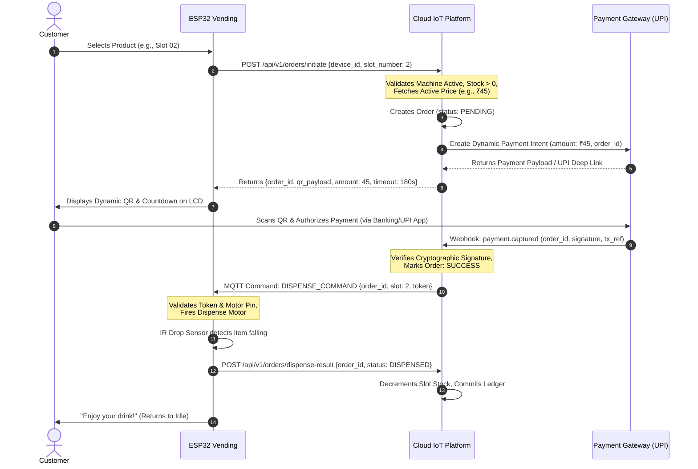
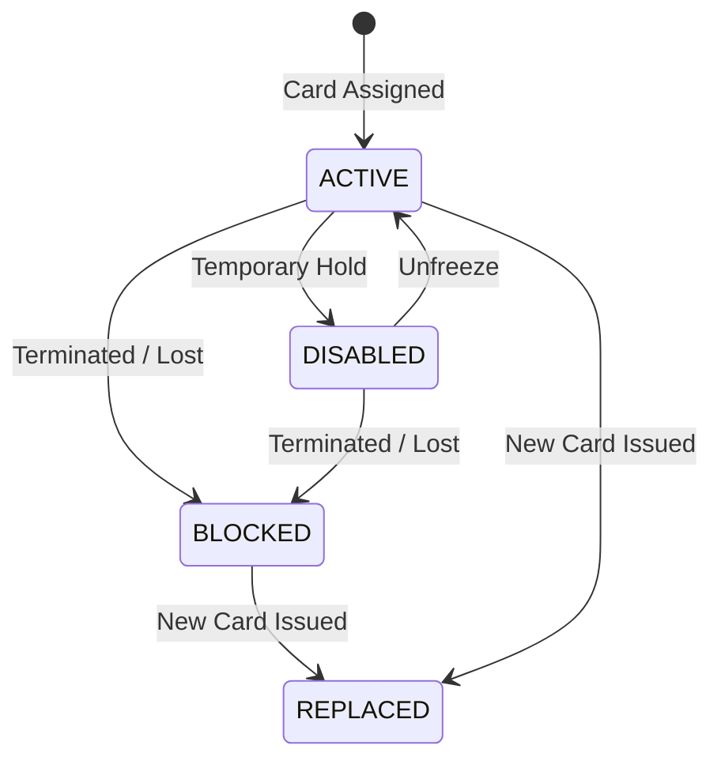

# Multi-Tenant Cloud IoT Platform Architecture
## Vending Machine & RFID Attendance Systems Fleet Platform

---

## 1. Executive Summary & System Overview

This document specifies the end-to-end system architecture for a commercial-grade, multi-tenant cloud IoT platform designed to manufacture, provision, deploy, monitor, and manage ESP32-based hardware fleets across distributed commercial clients.

The platform natively supports heterogeneous product families—starting with **Vending Machines** and **RFID Attendance Systems**—with an extensible modular architecture capable of accommodating future industrial IoT hardware (e.g., smart lockers, smart water dispensers, EV charging controllers).

```
+-----------------------------------------------------------------------------------------+
|                                    CLOUD PLATFORM                                       |
|                                                                                         |
|  +-------------------------+     +------------------------+     +--------------------+  |
|  |   Manufacturer Portal   |     |     Client Portal      |     |  Payment Gateway   |  |
|  |  (Fleet, OTA, Tenants)  |     |  (Dynamic by Modules)  |     | (Webhooks/Intents) |  |
|  +------------+------------+     +-----------+------------+     +---------+----------+  |
|               |                              |                            |             |
|               v                              v                            v             |
|  +-----------------------------------------------------------------------------------+  |
|  |                 API Gateway & Multi-Tenant Authorization Layer                    |  |
|  |              (JWT, RBAC, Tenant Discriminator, Module Policy Guards)              |  |
|  +-----------------------------------------------------------------------------------+  |
|                                              |                                          |
|         +------------------------------------+----------------------------------+       |
|         |                                    |                                  |       |
|         v                                    v                                  v       |
|  +--------------+                     +--------------+                   +-----------+  |
|  | Core Fleet & |                     | Vending &    |                   | RFID &    |  |
|  | Config Sync  |                     | Order Engine |                   | Access    |  |
|  +-------+------+                     +-------+------+                   +-----+-----+  |
|          |                                    |                                |        |
|          +--------------------+---------------+--------------------------------+        |
|                               |                                                         |
|                               v                                                         |
|  +-----------------------------------------------------------------------------------+  |
|  |            Message Broker & Device Gateway (MQTT over TLS / HTTPS REST)           |  |
|  |                   (mTLS, Device Identity, Topics Scoped by ID)                    |  |
|  +-----------------------------------------------------------------------------------+  |
+------------------------------------------+----------------------------------------------+
                                           |
                               Internet / TLS 1.3
                                           |
      +------------------------------------+-----------------------------------+
      |                                                                        |
      v                                                                        v
+-------------------------------+                            +-------------------------------+
|     ESP32 VENDING MACHINE     |                            |     ESP32 RFID ATTENDANCE     |
|   Device ID: VM-000001        |                            |   Device ID: RFID-000001      |
|                               |                            |                               |
|  [Core Services]              |                            |  [Core Services]              |
|  - TLS / MQTT Client          |                            |  - TLS / MQTT Client          |
|  - Config Manager (NVS)       |                            |  - Config Manager (NVS)       |
|  - OTA Dual-Bank Engine       |                            |  - OTA Dual-Bank Engine       |
|  - Offline Storage & Queue    |                            |  - Offline Storage & Queue    |
|                               |                            |                               |
|  [Optional Modules]           |                            |  [RFID Subsystem]             |
|  - QR Payment (Display/Order) |                            |  - Wiegand/SPI/I2C Reader     |
|  - Coin Acceptor (Pulse/MDB)  |                            |  - Local Card Whitelist Cache |
|  - RFID Dispense / Relay I/O  |                            |  - Buzzer / Status Indicator  |
|  - Drop Optical Sensor        |                            |  - IN/OUT Direction Logic     |
+-------------------------------+                            +-------------------------------+
```

---

## 2. Multi-Tenant Architecture

### 2.1 The Two-Tier Business Model
The platform enforces a strict separation between two primary operational tiers:

```
               [PLATFORM OWNER / MANUFACTURER]
                              |
       +----------------------+----------------------+
       |                                             |
       v                                             v
[CLIENT TENANT A]                             [CLIENT TENANT B]
(e.g., Apex Tech Parks)                       (e.g., Metro Retailers)
       |                                             |
       +--> VM-000001 (QR + Coin)                    +--> VM-000003 (Coin Only)
       +--> VM-000002 (QR Only)                      +--> RFID-000002 (Attendance)
       +--> RFID-000001 (Attendance)
```

1. **Platform Owner / Manufacturer (Super-Admin):**
   - Owns the physical hardware lifecycle: registers new devices, burns Device IDs, provisions device credentials.
   - Creates and manages client accounts (tenants).
   - Assigns devices to clients (or reassigns them).
   - Controls global feature availability and enables/disables hardware modules per device.
   - Maintains the firmware repository, signs binaries, and orchestrates OTA campaigns.
   - Monitors global fleet health, logs, alerts, and system-wide audit records.

2. **Client / Company Tenant:**
   - Isolated operational scope containing only devices assigned directly to their `client_id`.
   - Manages day-to-day operations: product catalog, slot prices, stock refills, employee rosters, and RFID card issuance.
   - Views reports and transactions (sales, cash collections, attendance records) strictly belonging to their machines.
   - Cannot see, configure, or query any other client's devices or telemetry.

### 2.2 Tenant Data Isolation Architecture
To guarantee that a client can **never** access another client's devices or data, tenant isolation is implemented at multiple architectural layers:

1. **Logical Data Segregation (Row-Level Scoping):**
   - Every tenant-scoped entity (`devices`, `orders`, `transactions`, `rfid_cards`, `employees`, `attendance_events`, `device_configs`) contains a mandatory, foreign-keyed `client_id` column.
   - Database queries issued on behalf of a tenant are automatically wrapped with a tenant predicate (e.g., `WHERE client_id = :current_tenant_id`).
   - Global indices compound on `(client_id, id)` and `(client_id, device_id)` to enforce isolation at the storage engine level.

2. **API & Service Layer Tenant Guards:**
   - Authentication tokens (JWT) contain the verified claims: `sub` (User ID), `tenant_id` (Client ID), and `role`.
   - An interceptor/middleware layer rejects any request where the path or payload specifies an entity not matching the token's `tenant_id` (returning `403 Forbidden`).
   - Manufacturer super-admins possess a wildcard tenant context (`tenant_id: null` or `role: SUPER_ADMIN`), granting fleet-wide access.

3. **MQTT Broker Topic Isolation:**
   - MQTT topics are strictly partitioned by Device ID and verified against the authenticated device identity:
     - Uplink telemetry: `devices/{device_id}/telemetry`
     - Heartbeats: `devices/{device_id}/heartbeat`
     - Downlink commands: `devices/{device_id}/commands`
     - Config updates: `devices/{device_id}/config`
     - OTA trigger: `devices/{device_id}/ota`
   - Broker authorization rules (ACLs) prevent any device from subscribing or publishing outside its designated `{device_id}` hierarchy.

### 2.3 Role-Based Access Control (RBAC) Matrix

| Role | Domain | Permissions |
|---|---|---|
| **MANUFACTURER_ADMIN** | Global / Platform | Full access: create tenants, register hardware, upload/sign firmware, trigger OTA, assign devices, toggle modules, inspect system audit logs. |
| **MANUFACTURER_SUPPORT** | Global / Platform | Read-only access to fleet diagnostics, logs, telemetry, and device statuses. |
| **CLIENT_ADMIN** | Tenant Scope | Full access within tenant: manage products, slot prices, stock levels, employee directory, RFID card lifecycle, view financial/attendance reports. |
| **CLIENT_OPERATOR** | Tenant Scope | Operational access: record stock refills, view machine stock levels, read-only access to pricing and reports. |
| **DEVICE_CLIENT** | Edge / Hardware | Hardware identity: publish telemetry, receive config/commands, fetch authorized OTA binaries for its own `device_id`. |

---

## 3. Device Identity & Lifecycle

### 3.1 Immutable Device Identity
Every physical ESP32 device manufactured receives an immutable, permanent **Device ID** burned into flash memory or cryptographic NVS during factory provisioning.

- **Naming Conventions:**
  - Vending Machines: `VM-XXXXXX` (e.g., `VM-000001`, `VM-000002`)
  - RFID Attendance Units: `RFID-XXXXXX` (e.g., `RFID-000001`, `RFID-000002`)
  - Format: `^[A-Z]{2,6}-[0-9]{6}$`

### 3.2 Device Hardware Tuple
In addition to the logical Device ID, the cloud platform registers a permanent hardware identity tuple:

```json
{
  "device_id": "VM-000001",
  "hardware_id": "HW-ESP32S3-V1.2",
  "chip_id": "ESP32-S3-D0WD-0x3C8427F8B12C",
  "mac_address": "3C:84:27:F8:B1:2C",
  "factory_serial": "MFG-2026-VM-000491",
  "provisioned_at": "2026-10-05T10:00:00Z"
}
```

The ESP32 reads its factory MAC and chip identity directly from hardware eFuses. The cloud validates this tuple upon initial registration to prevent Device ID spoofing.

### 3.3 Device Lifecycle State Machine

```
   [FACTORY PROVISIONED]
             |
             v  (Assigned to Client)
        [ASSIGNED]
             |
             v  (First Cloud Handshake)
         [ACTIVE] <-----------------------+
        /        \                        |
       /          \                       |
      v            v                      |
 [SUSPENDED]   [MAINTENANCE]              |
      |            |                      |
      +------------+---- (Re-activated) --+
             |
             v  (Hardware Retired)
     [DECOMMISSIONED]
```

- **PROVISIONED:** Hardware assembled, identity burned, certificates flashed. Not yet assigned to any client.
- **ASSIGNED:** Linked to a specific client organization. Ready for on-site field deployment.
- **ACTIVE:** Device is deployed, successfully handshaking with cloud, receiving configs, and serving transactions.
- **SUSPENDED:** Temporarily locked by manufacturer or client (e.g., billing dispute, security investigation). Cloud rejects commands and transactions.
- **MAINTENANCE:** On-site technician mode. Field diagnostics enabled, transaction processing paused.
- **DECOMMISSIONED:** Hardware retired or destroyed. Credentials permanently revoked.

### 3.4 Runtime State Tracking
The cloud continuously tracks real-time operational telemetry reported via periodic heartbeats (default: every 60 seconds):

```json
{
  "device_id": "VM-000001",
  "status": "ONLINE",
  "last_heartbeat": "2026-10-05T15:00:00Z",
  "current_firmware_version": "v1.2.0",
  "current_config_version": 27,
  "wifi_rssi": -58,
  "free_heap_bytes": 184320,
  "uptime_seconds": 86420,
  "active_errors": []
}
```

---

## 4. Product Type & Module Architecture

### 4.1 Extensible Product Type Registry
The platform models hardware types generically so new industrial products can be introduced without altering core database schemas or messaging pipelines:

```
[Device Type Entity]
  - code: VENDING_MACHINE | RFID_ATTENDANCE | SMART_LOCKER | ...
  - name: Human-readable display label
  - capability_schema: JSON Schema defining supported modules and configurations
```

### 4.2 Modular Feature Flags
For a given product type, hardware functionality is broken down into independent **Modules**. For Vending Machines, three initial modules are defined:

1. `QR_PAYMENT`: Dynamic UPI/QR code payment display and gateway reconciliation.
2. `COIN_PAYMENT`: Hardware multi-coin acceptor pulse processing and autonomous offline credit handling.
3. `RFID_ACCESS`: Card-based dispense authentication (e.g., corporate subsidized vending).

Modules are **configured per physical device** in the database. Examples:
- `VM-000001`: `QR_PAYMENT = true`, `COIN_PAYMENT = false`, `RFID_ACCESS = false` (Pure digital kiosk)
- `VM-000002`: `QR_PAYMENT = false`, `COIN_PAYMENT = true`, `RFID_ACCESS = false` (Rural coin machine)
- `VM-000003`: `QR_PAYMENT = true`, `COIN_PAYMENT = true`, `RFID_ACCESS = false` (Hybrid payment machine)

### 4.3 Client Dashboard Dynamic Feature Visibility & Backend Enforcement
A core platform guarantee: **The client dashboard must dynamically adapt to enabled modules, and the backend must strictly enforce authorization.**

```
+-----------------------------------------------------------------------------------+
|                        DYNAMIC VISIBILITY & ENFORCEMENT                           |
|                                                                                   |
|  Device Configuration:                                                            |
|  - QR_PAYMENT: ENABLED                                                            |
|  - COIN_PAYMENT: DISABLED                                                         |
|                                                                                   |
|  [Client Web Portal]                                [Backend API Gateway]         |
|  +-------------------------------------+            +---------------------------+ |
|  | [x] QR Payment Settings             |            | GET  /api/v1/qr/...       | |
|  | [x] QR Transaction Logs             | ---------> | -> 200 OK (Allowed)       | |
|  | [x] Dynamic UPI Gateway Config      |            +---------------------------+ |
|  |                                     |                                          |
|  | [ ] Coin Settings     (HIDDEN)      |            +---------------------------+ |
|  | [ ] Coin Denom Config (HIDDEN)      |            | POST /api/v1/coins/...    | |
|  | [ ] Coin Cash Audit   (HIDDEN)      | --(Forge)->| -> 403 MODULE_DISABLED    | |
|  +-------------------------------------+            +---------------------------+ |
+-----------------------------------------------------------------------------------+
```

- **Frontend Visibility Rules:** UI navigation bars, configuration panels, and data tables only render controls for modules currently active on the selected device.
- **Backend Policy Enforcement:** API route handlers execute a `ModuleGuard`. Even if a client crafts a direct HTTP request to coin configuration endpoints for a QR-only machine, the backend evaluates `device.modules.includes('COIN_PAYMENT')` and responds with `403 Forbidden` (`MODULE_NOT_ENABLED_FOR_DEVICE`).

---

## 5. Vending Machine Subsystem Architecture

### 5.1 Hardware Topology
The ESP32 Vending Controller interfaces with:
- **Keypad / Selection Matrix:** Input for slot selection (e.g., Slot 1 to 24).
- **Graphic Display:** 3.5" to 7" TFT / LCD (SPI or parallel) to display product name, price, dynamic QR code, and countdown timer.
- **Dispense Actuators:** Relay board or motor driver matrix (ULN2803 / MOSFETs) controlling 24V DC spiral motors.
- **Drop Sensor:** Infrared beam break / optical sensor detecting physical falling product into the retrieval bin.
- **Coin Acceptor:** Electronic pulse/serial multi-coin acceptor.

```
+-------------------------------------------------------------------------------+
|                             ESP32 VENDING NODE                                |
|                                                                               |
|   +-------------------+       +--------------------+       +---------------+  |
|   |  Keypad / Matrix  | ----> |    ESP32 Core      | <---> |  TFT Display  |  |
|   +-------------------+       |  - State Machine   |       | (Dynamic QR)  |  |
|                               |  - NVS Config      |       +---------------+  |
|   +-------------------+       |  - TLS / MQTT      |                          |
|   |   Coin Acceptor   | ----> |  - Drop Detection  | ----> +---------------+  |
|   |  (Pulse / Serial) |       +---------+----------+       | Spiral Motors |  |
|   +-------------------+                 |                  | (Dispense I/O)|  |
|                                         v                  +-------+-------+  |
|                               +-------------------+                |          |
|                               | Drop Sensor (IR)  | <--------------+          |
|                               +-------------------+        (Physical Drop)    |
+-------------------------------------------------------------------------------+
```

### 5.2 Product & Slot Management
Vending slots are mapped to products via cloud configuration. Products have dynamic attributes:
- **Product Entity:** `id`, `client_id`, `product_code`, `name`, `description`, `price_in_cents` (or paise), `image_url`.
- **Machine Slot Entity:** `slot_id` (e.g., `SLOT-01`), `product_id`, `current_stock`, `capacity`, `motor_pin`, `dispense_pulse_ms`.

#### Decoupled Pricing Architecture
**Prices are pure configuration data.** When a client changes the price of a beverage from ₹40 to ₹45:
1. Client updates price in Client Dashboard.
2. Cloud creates an incremented configuration version (e.g., version 26 becomes version 27).
3. Cloud pushes the new configuration to the ESP32 (or ESP32 fetches it upon next sync).
4. ESP32 updates its local non-volatile storage.
5. **No firmware recompilation or OTA flashing is ever performed for pricing or product updates.**

---

## 6. QR Payment Architecture (Transaction-Based Dynamic QR)

### 6.1 Architectural Mandate
Static QR codes with hardcoded product prices are **strictly prohibited**. Static QRs suffer from:
- Inability to update prices dynamically.
- Zero correlation between customer payment and machine dispense state.
- Severe vulnerability to customer overpayment, underpayment, or fraud.

All QR payments are **ephemeral, transaction-based dynamic payment intents**.

### 6.2 End-to-End Sequence Diagram



### 6.3 Security Rules for QR Dispense
- The ESP32 is a consumer of authorization—it **never** decides on its own that a digital payment succeeded.
- Dispense commands issued by the cloud contain an HMAC token signed with the device's shared secret and an expiration nonce (valid for 30 seconds only).
- If the drop sensor fails to detect a falling item (jammed coil), the ESP32 posts `DISPENSE_FAILED`. The cloud automatically marks the order for an automated refund through the payment gateway.

---

## 7. Coin Payment Architecture

### 7.1 Hardware Interfacing & Signal Conditioning
The coin subsystem interfaces with standard multi-coin acceptors using pulse trains or serial protocols:
- **Pulse Train Mode:** Each denomination generates a discrete pulse count (e.g., ₹1 = 1 pulse, ₹2 = 2 pulses, ₹5 = 5 pulses, ₹10 = 10 pulses).
- **Hardware Debouncing:** An optical isolator or hardware RC low-pass filter cleans signal noise, and the ESP32 GPIO interrupt driver validates pulse width (typically 40ms high, 60ms low) to reject electrical transients.

### 7.2 Autonomous Edge Credit Accumulator
Unlike QR payments which require real-time cloud coordination, coin transactions must function **completely offline**:

```
+---------------------------------------------------------------------------------+
|                         EDGE COIN DISPENSE LOGIC                                |
|                                                                                 |
| Customer Inserts Coins -> ESP32 Interrupt -> Accumulates Credit in RAM          |
|                                                                                 |
| [Accumulated Credit: ₹30]  >=  [Slot Price: ₹30 (Cached from Config Version)]   |
|                                  |                                              |
|                                  v                                              |
|                     Activate Dispense Motor Relay                               |
|                                  |                                              |
|                     Optical Drop Sensor Confirms                                |
|                                  |                                              |
|            +---------------------+---------------------+                        |
|            |                                           |                        |
|            v (Dispense OK)                             v (Change Due)           |
|  Write Transaction to LittleFS               Trigger Coin Hopper Return         |
|  Offline Ring Buffer:                        (if change mechanism fitted)       |
|  {tx_uuid, amount, slot, timestamp}                                             |
|            |                                                                    |
|            v (When Internet Connected)                                          |
|  Sync Transaction Batch to Cloud Ledger                                         |
+---------------------------------------------------------------------------------+
```

### 7.3 Hybrid Mode Operation
When both `QR_PAYMENT` and `COIN_PAYMENT` are enabled on a machine:
- The UI prompts: *"Select Product, then Insert Coins OR Scan QR to Pay"*.
- If coins are inserted, the QR timer is cancelled, and the screen displays accumulated cash credit.
- If the user selects QR, dynamic QR generation proceeds as normal.

---

## 8. RFID Attendance Subsystem Architecture

### 8.1 Hardware Topology
The RFID Attendance unit comprises:
- **RFID Module:** RC522 (SPI) for 13.56 MHz Mifare Classic/Desfire, or PN532 (I2C/UART), or Wiegand 26/34 interface.
- **Status Indicators:** Dual LED (Green for authorized/synced, Red for rejected/blocked) and Piezo Buzzer for audible beeps.
- **Display:** 16x2 / 20x4 I2C LCD or OLED displaying Employee Name, Event Type, and Timestamp.

### 8.2 Entity Hierarchy & Lifecycle

```
[Client / Tenant]
       |
       +--> [Departments / Branches]
                  |
                  +--> [Employees / Students]
                             |
                             +--> [RFID Cards]
```

#### Card Status Lifecycle
To preserve the legal and audit integrity of attendance records, **RFID cards are never permanently deleted from the database** if attendance events reference them:

- `ACTIVE`: Card is authorized for scanning and attendance recording.
- `DISABLED`: Temporarily deactivated (e.g., employee on leave, card misplaced).
- `BLOCKED`: Permanently barred (e.g., reported stolen, terminated employee).
- `REPLACED`: Superseded by a new card UID. The old card record is marked `REPLACED` with a foreign key pointer to `replacement_card_id`.



### 8.3 Attendance Processing Flow
When an RFID card is tapped:
1. ESP32 captures card UID (e.g., `04:A3:92:7B:11:65`).
2. Checks local NVS/RAM card whitelist cache:
   - If blocked/unknown: Red LED, double buzzer beep, displays *"ACCESS DENIED"*.
   - If active: Green LED, single chime, displays *"Welcome, Arun Kumar"*.
3. Generates Attendance Event payload:
   ```json
   {
     "event_uuid": "c3b8a1e2-9d3f-4e6a-8b1c-7f5a2e4d9c01",
     "device_id": "RFID-000001",
     "card_uid": "04:A3:92:7B:11:65",
     "employee_code": "EMP001",
     "timestamp": "2026-10-05T08:57:32Z",
     "event_type": "IN"
   }
   ```
4. If online: Transmits immediately via MQTT / HTTPS to Cloud.
5. If offline: Writes to local LittleFS attendance queue for automatic synchronization upon reconnect.

---

## 9. Offline Resilience & Edge Synchronization

### 9.1 Edge Storage Layout
ESP32 flash memory is partitioned to support robust offline operation:

```
+--------------------------------------------------------------------+
|                      ESP32 FLASH PARTITION MAP                     |
+------------+------------+------------+---------------+-------------+
| Bootloader | NVS Config | OTA Bank 0 |  OTA Bank 1   |  LittleFS   |
|   (64KB)   |  (128KB)   | (1792KB)   |   (1792KB)    |  (320KB)    |
+------------+------------+------------+---------------+-------------+
                                                              |
                 +--------------------------------------------+
                 |
                 +--> /offline_queue/
                 |    - pending_attendance.bin (Circular Queue)
                 |    - pending_coin_tx.bin
                 +--> /cache/
                      - card_whitelist.bin (Compact hash table)
                      - active_config.json
```

### 9.2 Reconnection & Deduplication Protocol
When internet connectivity is restored after an outage:
1. ESP32 re-establishes TLS connection with Cloud MQTT broker.
2. Background synchronization task reads queued records in FIFO batches (e.g., 20 events per batch).
3. Payload includes the unique `event_uuid` generated at the physical instant of the scan.
4. **Idempotency Guarantee:** The cloud database enforces a unique constraint on `(device_id, event_uuid)`. If network retries cause duplicate transmissions, the cloud acknowledges receipt without creating duplicate records.

---

## 10. Versioned Cloud Configuration Architecture

### 10.1 Schema & Versioning Strategy
Every device maintains a discrete, monotonically increasing `configuration_version` integer.

```json
{
  "device_id": "VM-000001",
  "config_version": 27,
  "updated_at": "2026-10-05T14:30:00Z",
  "modules": {
    "QR_PAYMENT": true,
    "COIN_PAYMENT": false,
    "RFID_ACCESS": false
  },
  "telemetry": {
    "heartbeat_interval_sec": 60,
    "log_level": "INFO"
  },
  "vending": {
    "drop_sensor_timeout_ms": 4500,
    "slots": [
      {"slot_id": 1, "product_code": "WATER-01", "name": "Mineral Water", "price": 2000, "stock": 15},
      {"slot_id": 2, "product_code": "COKE-01", "name": "Coca Cola", "price": 4500, "stock": 8}
    ]
  }
}
```

### 10.2 Configuration Handshake & Delta Sync
1. Every heartbeat from the ESP32 includes its `current_config_version`.
2. Cloud compares `heartbeat.config_version` against `device.target_config_version`.
3. If `target > current`:
   - Cloud publishes configuration update payload to `devices/{device_id}/config`.
   - ESP32 parses JSON, verifies schema integrity and checksum, writes to NVS.
   - ESP32 replies with `CONFIG_ACK` containing the new version number.
   - Cloud marks configuration as synchronized.

---

## 11. Firmware OTA Architecture

### 11.1 Cryptographic Verification & Dual-Bank Boot
To safeguard mission-critical unattended hardware from bricking during remote updates:
- **Dual Partitioning (A/B System):** The ESP32 partition table allocates two identical application slots (`ota_0` and `ota_1`). Firmware is downloaded into the inactive partition.
- **Cryptographic Signature:** Every binary is signed at build time using an RSA-2048 or ECDSA-P256 private key held exclusively in the manufacturer's secure build pipeline. The ESP32 verifies the binary signature using a public key burned into hardware eFuses before committing the image.

```
       +-------------------------------------------------------+
       |             MANUFACTURER FIRMWARE REPO                |
       |  - Version: v1.2.0                                    |
       |  - Target HW: HW-ESP32S3-V1.2                         |
       |  - SHA-256: 8f4a3c...                                 |
       |  - Signature: ECDSA-P256 Signature Header             |
       +---------------------------+---------------------------+
                                   |
                         OTA Deployment Trigger
                        (Canary / Client / Fleet)
                                   |
                                   v
+--------------------------------------------------------------------+
|                             ESP32                                  |
|                                                                    |
| 1. Receives OTA Manifest via MQTT                                  |
| 2. Downloads chunked binary over HTTPS (TLS 1.3)                   |
| 3. Streams bytes directly to INACTIVE partition (ota_1)            |
| 4. Computes SHA-256 on the fly & verifies digital signature        |
| 5. esp_ota_set_boot_partition(ota_1)                               |
| 6. Reboots into ota_1                                              |
|                                                                    |
| [SELF-DIAGNOSTIC TEST STAGE]                                       |
| 7. Boots up, initializes hardware drivers                          |
| 8. Establishes Wi-Fi/Cellular connection & connects to MQTT        |
| 9. If all tests pass within 120s:                                  |
|    -> esp_ota_mark_app_valid_cancel_rollback()                     |
|    -> Reports OTA_SUCCESS to Cloud                                 |
|                                                                    |
| [AUTOMATIC ROLLBACK TRIGGER]                                       |
| 10. If crash / watchdog timeout / cannot connect to cloud:         |
|     -> Hardware watchdog resets board                              |
|     -> Bootloader detects unconfirmed partition                    |
|     -> Automatically rolls back and boots original partition ota_0|
|     -> Reports OTA_ROLLED_BACK to Cloud                            |
+--------------------------------------------------------------------+
```

### 11.2 Targeted OTA Deployments
The manufacturer portal allows granular rollout controls:
- **Single Device Canary:** Deploy to one test unit in the lab or field.
- **Client Organization:** Deploy to all devices assigned to a specific client.
- **Device Model / Batch:** Deploy to all `VM-XXXXXX` hardware revision 1.2 units.
- **Full Fleet Rollout:** Phased rollout across all deployed units with automated pause on error threshold breach.

---

## 12. Security Architecture

### 12.1 Defense in Depth Matrix

| Vector | Security Control | Description |
|---|---|---|
| **Transport Layer** | TLS 1.3 / MQTTS | All traffic over HTTPS (port 443) and MQTT over TLS (port 8883) with modern cipher suites. No unencrypted plaintext communication. |
| **Device Authentication** | Unique Device Credentials | Each ESP32 possesses a unique pre-shared cryptographically strong key or X.509 client certificate generated at manufacturing time. No global passwords. |
| **Client Isolation** | Scoped Database Access | Application layer and database queries strictly filter by `client_id`. Cross-tenant data leakage is architecturally blocked. |
| **User Authentication** | OAuth2 / JWT + Argon2id | User passwords hashed using Argon2id with per-user salts. JWT tokens carry short expirations (15 mins) and rotating refresh tokens. |
| **Firmware Integrity** | ECDSA Digital Signatures | Firmware binaries verified by hardware bootloader prior to execution. Malicious or corrupted payloads are rejected. |
| **Secret Management** | Zero Code Credentials | Database credentials, API signing keys, and payment gateway secrets loaded strictly via environment variables and cloud key management vaults. |
| **Rate Limiting** | Token Bucket Limiting | API endpoints and MQTT gateway implement per-IP and per-device rate limiting to mitigate denial of service attempts. |
| **Audit Trails** | Immutable Change Logs | All administrative actions (price updates, card status modifications, device reassignments, OTA triggers) recorded with user ID, IP, and timestamp. |

---

## 13. Future Scalability Architecture

To seamlessly scale from 100 devices to 100,000+ concurrent connected units:
1. **MQTT Broker Clustering:** Deploy clustered EMQX or VerneMQ brokers behind Layer 4 TCP load balancers with sticky sessions and distributed state.
2. **Database Partitioning:** Time-series tables (`device_heartbeats`, `attendance_events`, `transactions`) partitioned by monthly ranges with automatic retention pruning.
3. **Decoupled Background Workers:** Asynchronous event queues (Redis Streams / Celery / BullMQ) ingest webhooks, process batch attendance syncs, and generate PDF reports without blocking real-time API threads.
4. **Edge Computing Optimization:** ESP32 firmware leverages dual-core FreeRTOS architecture: Core 0 dedicated to real-time network protocol stacks and crypto; Core 1 dedicated to hardware pulse interrupts, keypad scanning, and motor control.

---
*Document Version: 1.0.0 — Phase 1 Architecture Foundation Specification*
